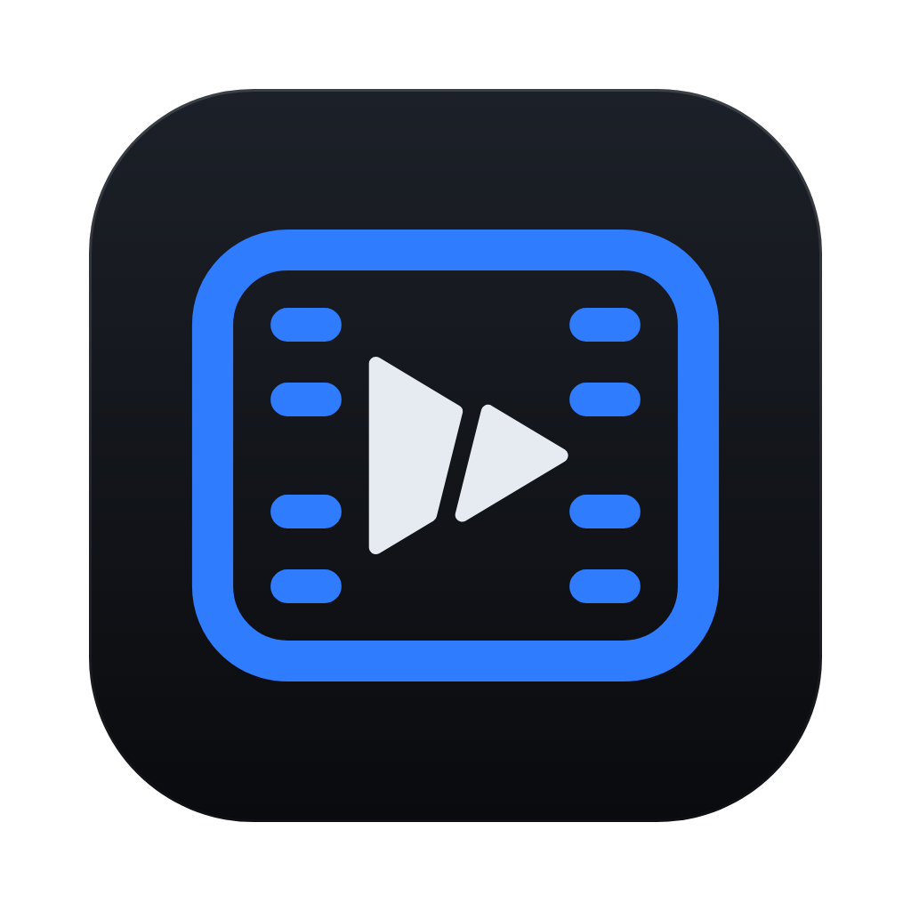
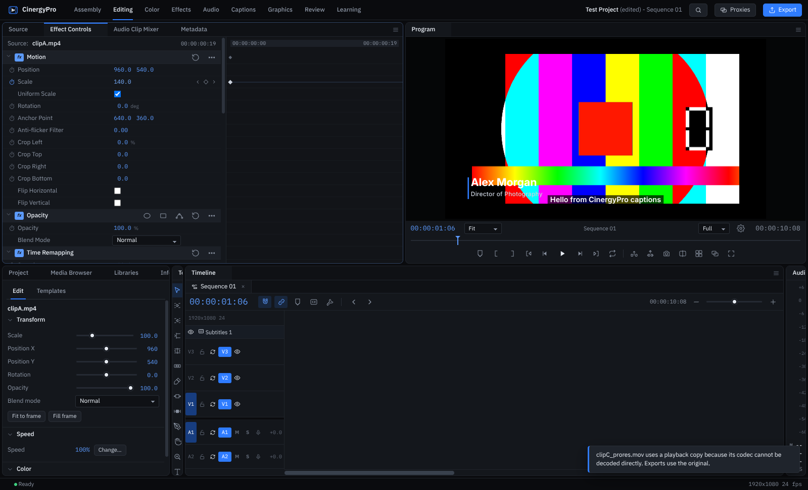
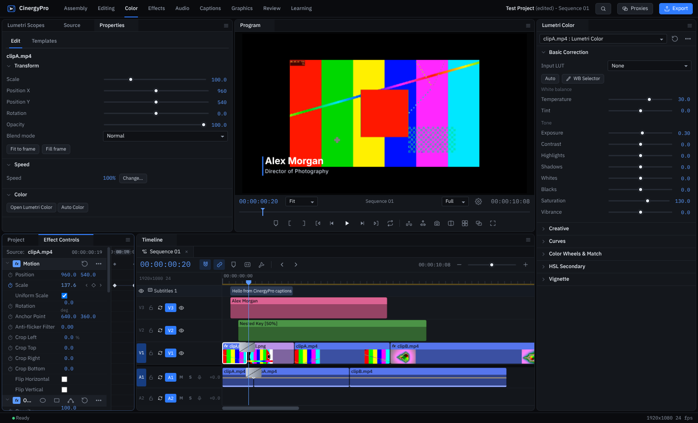
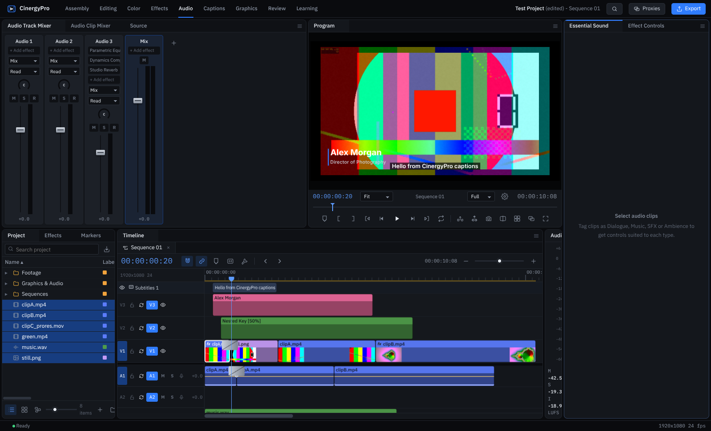
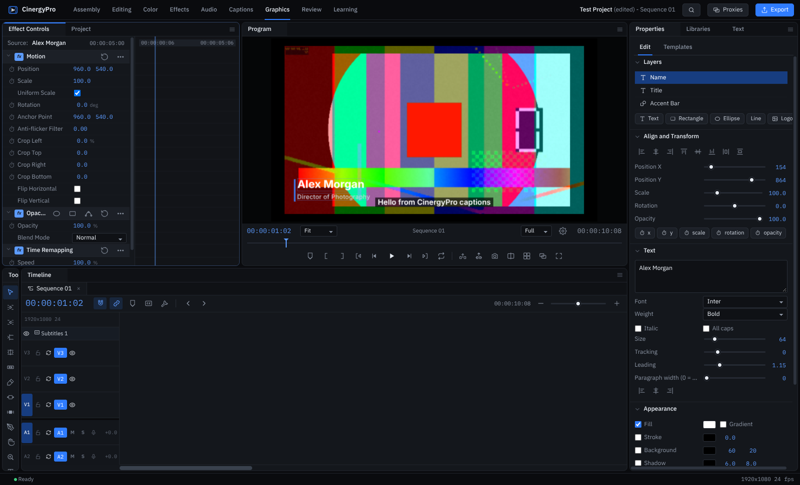
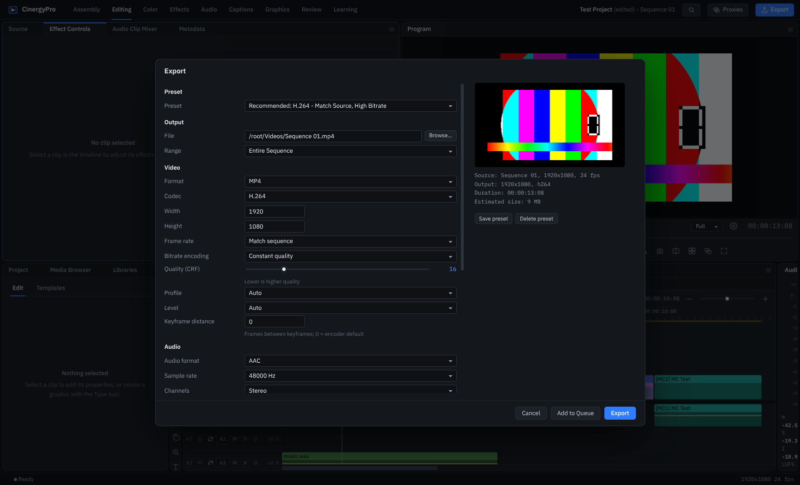

<p align="center"></p>

# CinergyPro

Craft Every Frame.

CinergyPro is a desktop video editor for macOS and Windows. It has a multi-track timeline, source and program monitors, a Lumetri-style color panel with scopes, an audio mixer with track effects, titles and captions, multicam, nested sequences, keyframes, and export through ffmpeg to H.264, HEVC, ProRes, DNxHR, VP9, GIF, audio-only formats and image sequences.

It is built with Electron 45. Video compositing runs on WebGL2 in 16-bit float, audio runs on the Web Audio API with AudioWorklets, and ffmpeg/ffprobe handle decoding, proxies, analysis and encoding.



## Contents

- [Install a built copy](#install-a-built-copy)
- [Run from source](#run-from-source)
- [Build the apps yourself](#build-the-apps-yourself)
- [Run the tests](#run-the-tests)
- [Put this repository on GitHub from your Mac](#put-this-repository-on-github-from-your-mac)
- [Automatic builds with GitHub Actions](#automatic-builds-with-github-actions)
- [Features](#features)
- [Keyboard shortcuts](#keyboard-shortcuts)
- [Scripting and plugins](#scripting-and-plugins)
- [Where CinergyPro keeps your data](#where-cinergypro-keeps-your-data)
- [Repository layout](#repository-layout)
- [How it works](#how-it-works)
- [Troubleshooting](#troubleshooting)
- [What is not included](#what-is-not-included)
- [Licenses](#licenses)

## Install a built copy

Built files are named like this (the version number changes with each release):

| File | For |
|---|---|
| `CinergyPro-1.0.0-mac-arm64.zip` | Macs with Apple Silicon (M1, M2, M3, M4) |
| `CinergyPro-1.0.0-mac-x64.zip` | Macs with an Intel processor |
| `CinergyPro-1.0.0-win-x64-setup.exe` | Windows 10 and 11, installer |
| `CinergyPro-1.0.0-win-x64.zip` | Windows 10 and 11, portable copy with no installer |

To check which Mac you have, open the Apple menu, choose About This Mac, and read the Chip or Processor line.

### macOS

1. Unzip the file and drag `CinergyPro.app` into `/Applications`.
2. Open Terminal and run the block below once. The app is not signed with an Apple Developer ID or notarized, so macOS blocks it until it has a local ad-hoc signature and the download quarantine flag is removed. Without this step the app either shows "CinergyPro is damaged" or is killed the moment it starts (`zsh: killed` in Terminal, "Security policy would not allow process" in the system log).

```bash
APP="/Applications/CinergyPro.app"
xattr -cr "$APP"
codesign --force --sign - "$APP/Contents/Resources/bin/ffmpeg" "$APP/Contents/Resources/bin/ffprobe"
find "$APP/Contents/Frameworks" -depth \( -name "*.dylib" -o -name "*.framework" -o -name "*.app" -o -name "chrome_crashpad_handler" \) -exec codesign --force --sign - {} \;
codesign --force --sign - "$APP"
codesign --verify --deep --strict --verbose=2 "$APP"
xattr -l "$APP"
```

What each line does:

- `xattr -cr` removes the quarantine flag that the browser added when you downloaded the zip.
- The first `codesign` signs the bundled ffmpeg and ffprobe.
- The `find ... -exec codesign` line signs every helper app, framework and library inside the bundle, innermost first, because macOS checks nested code before the outer app.
- `codesign --force --sign - "$APP"` signs the app itself last.
- `codesign --verify` should print `valid on disk` and `satisfies its Designated Requirement`.
- `xattr -l` should no longer list `com.apple.quarantine`.

The same commands are saved in this repository as `scripts/sign-mac.sh`, so you can also run:

```bash
./scripts/sign-mac.sh                      # signs /Applications/CinergyPro.app
./scripts/sign-mac.sh ~/Desktop/CinergyPro.app
```

3. Open CinergyPro. If macOS still refuses, open System Settings > Privacy & Security, scroll down, and click Open Anyway next to CinergyPro.

You need to repeat step 2 every time you replace the app with a newly downloaded copy. A copy you build yourself on your own Mac with `npm run dist:mac` is signed during the build and has no quarantine flag, so it opens directly.

### Windows

Run `CinergyPro-1.0.0-win-x64-setup.exe`. It installs for your user account only (no administrator prompt) into `%LOCALAPPDATA%\Programs\CinergyPro`. It also adds Start Menu and Desktop shortcuts, registers `.cinergy` project files, and adds an entry under Settings > Apps for uninstalling.

The installer is not code-signed, so Windows SmartScreen shows "Windows protected your PC". Click More info, then Run anyway.

For the portable copy, unzip `CinergyPro-1.0.0-win-x64.zip` anywhere and run `CinergyPro.exe`.

There is no native Windows on ARM build. The x64 build runs there under Windows' x64 emulation, more slowly.

## Run from source

You need:

- Node.js 20 or newer (`node -v` to check). On a Mac: `brew install node`, or the installer from nodejs.org.
- git (included with the Xcode Command Line Tools on a Mac: `xcode-select --install`).

```bash
git clone https://github.com/<your-username>/cinergypro.git
cd cinergypro
npm install
npm run fetch-ffmpeg
npm start
```

`npm run fetch-ffmpeg` downloads ffmpeg and ffprobe for your machine into `bin/<os>-<arch>/` (about 90 MB on a Mac). The `bin/` folder is in `.gitignore`, so the binaries are never committed. If you skip this step, CinergyPro looks for ffmpeg in `/opt/homebrew/bin`, `/usr/local/bin`, `/usr/bin` and your `PATH`, so `brew install ffmpeg` also works.

ffmpeg is searched for in this order:

1. The `CINERGY_FFMPEG` and `CINERGY_FFPROBE` environment variables
2. `Contents/Resources/bin` inside a packaged app
3. `bin/<os>-<arch>/` in the repository
4. Homebrew and system locations, then `PATH`

On Linux, start with `npx electron . --no-sandbox`. Linux is used for development and automated tests, and there is no packaged Linux build.

Environment variables for development:

| Variable | Effect |
|---|---|
| `CINERGY_DEVTOOLS=1` | Opens Chromium DevTools in a detached window |
| `CINERGY_LOG=1` | Prints renderer console messages to the terminal |
| `CINERGY_FFMPEG`, `CINERGY_FFPROBE` | Use specific ffmpeg/ffprobe binaries |

## Build the apps yourself

All build output goes to `dist/`.

### macOS (build on a Mac)

```bash
npm run dist:mac          # Apple Silicon and Intel zips
npm run dist:mac:arm64    # Apple Silicon only, faster
```

The script downloads the ffmpeg builds for both architectures, packages the app, and ad-hoc signs it with `scripts/sign-mac.sh` (from the `afterPack` hook in `build/afterPack.js`). The result is `dist/mac-arm64/CinergyPro.app` and the matching zips. Signing only happens when the build runs on macOS. A Mac app built on Linux or Windows still needs `scripts/sign-mac.sh` run on the Mac.

### Windows (build on Windows, macOS or Linux)

```bash
npm run dist:win
```

This produces `dist/CinergyPro-1.0.0-win-x64.zip` and `dist/CinergyPro-1.0.0-win-x64-setup.exe`. The `.exe` icon and version details are written with `resedit`, and the installer is compiled from `build/installer.nsi` with NSIS's `makensis`. Neither step needs Wine. `build/make-installer.js` looks for `makensis` in the electron-builder cache, then in the usual install locations. If it cannot find one, install NSIS:

| System | Command |
|---|---|
| macOS | `brew install makensis` |
| Windows | `choco install nsis` or the installer from nsis.sourceforge.io |
| Debian/Ubuntu | `sudo apt install nsis` |

### Changing the version or icon

- Version: edit `"version"` in `package.json`. File names and the installer pick it up.
- Icon: `build/icon.svg` is the source. `build/icon.png` (1024 px) is used for macOS and `build/icon.ico` for Windows. The logo inside the app is the `i-logo` symbol in `renderer/index.html`.

## Run the tests

```bash
npm test             # full run, includes long export renders
npm run test:quick   # skips the slow exports
```

`scripts/run-tests.js` generates six synthetic clips with ffmpeg (H.264 with audio, a 1080p clip, ProRes, a green-screen clip, a WAV and a PNG) in `test-output/media/`. It then starts the app with `--test`, which runs `renderer/js/test-harness.js` inside the real window. The harness covers:

- Editing: project creation, import, insert and overwrite, undo/redo, razor and ripple delete, trims.
- Effects: transitions, keyframes, chroma key, every video effect, transition and audio effect compiled and rendered.
- Graphics: titles and captions.
- Audio: music with track effects.
- Sequences: nesting and speed changes.
- Interchange round-trips: OTIO, EDL, FCP XML, FCPXML, SRT.
- Exports: H.264 with captions and timecode burn-in, ProRes, WAV with loudness normalization, still frames, render previews.
- Workflows: multicam, audio sync, scene detection, stabilization, scripting.
- Dialogs, plus screenshots of each workspace.

The runner prints one line per step, ends with `SUMMARY n/n passed`, and exits non-zero if anything failed. Screenshots and exported files stay in `test-output/`.

## Put this repository on GitHub from your Mac

1. Unzip the repository and open Terminal in that folder:

```bash
cd ~/Downloads/cinergypro
```

2. Tell git who you are, if you have never done this on this Mac:

```bash
git config --global user.name "Your Name"
git config --global user.email "you@example.com"
```

3. Create the local repository and the first commit:

```bash
git init -b main
git add .
git commit -m "CinergyPro 1.0.0"
```

4. Create the GitHub repository and push. Choose one of these two ways.

With the GitHub CLI (`brew install gh`, then `gh auth login` once):

```bash
gh repo create cinergypro --private --source=. --remote=origin --push
```

Use `--public` instead of `--private` if you want it public, but read [Licenses](#licenses) first.

Without the CLI: create an empty repository named `cinergypro` at github.com/new (no README, no .gitignore, no license, because this folder already has them). Then run:

```bash
git remote add origin https://github.com/<your-username>/cinergypro.git
git push -u origin main
```

When git asks for a password, paste a personal access token (github.com > Settings > Developer settings > Personal access tokens), not your account password.

5. Later changes:

```bash
git add .
git commit -m "Describe the change"
git push
```

`node_modules/`, `dist/`, `bin/` and `test-output/` are excluded by `.gitignore`. That keeps the repository at about 3 MB and avoids GitHub's 100 MB file limit (the ffmpeg binaries alone are 46 to 81 MB each).

## Automatic builds with GitHub Actions

`.github/workflows/build.yml` builds the macOS zips on a macOS runner and the Windows zip and installer on a Windows runner.

- Start a build by hand: on GitHub, open Actions > Build > Run workflow. The files appear under the run's Artifacts.
- Make a release: push a version tag. The workflow builds both platforms and attaches the files to a GitHub Release for that tag.

```bash
git tag v1.0.0
git push origin v1.0.0
```

Mac builds made in Actions are ad-hoc signed on the runner. A copy downloaded from the Release page still gets the quarantine flag from your browser, so run the signing block from [macOS](#macos) once after installing.

## Features



### Workspace and interface

- Nine workspaces: Assembly, Editing, Color, Effects, Audio, Captions, Graphics, Review, Learning. Panels dock, split, stack as tabs, float, maximize (`` ` ``) and pop out into their own windows. Layout changes can be saved as new workspaces or reset.
- Panels: Project, Media Browser, Libraries, Info, Source and Program monitors, Timeline, Tools, Effect Controls, Effects, Lumetri Color, Lumetri Scopes, Audio Clip Mixer, Audio Track Mixer, Essential Sound, Text, Properties (graphics), Markers, History, Metadata, Production, Export Queue, Learn, Script Console.
- Home screen with recent projects, a searchable command palette (`Cmd+Shift+P`), a fully editable shortcut map, preferences, and three interface brightness levels.

### Media and projects

- Import files and whole folders (folders become bins), image sequences, layered PSD files (as a flattened image or one layer per track), audio files, captions (SRT, VTT) and timelines (OTIO, EDL, FCP 7 XML, FCPXML).
- Media Browser with favorites and volume or drive listing. Ingest on import can copy media, transcode it, or create proxies.
- Proxies in H.264, ProRes or DNxHR, with a header toggle that switches between proxies and originals. Exports always use the originals.
- Files the browser engine cannot decode directly (ProRes, DNxHR, MXF and others) get a playback copy automatically.
- Bins, labels, metadata columns, search bins, item duplication, interpret footage (frame rate, alpha, pixel aspect), clip in/out, subsequences, relinking of offline media.
- Project files (`.cinergy`) are JSON. There is auto save with versioned backups, crash recovery, and a lock that marks a project as in use. The Production panel groups the projects in a folder and shows which ones are open elsewhere.

### Timeline editing

- Unlimited video, audio and caption tracks. Track targeting, sync lock, lock, mute, solo, hide, plus adjustable track heights.
- Insert, overwrite, replace, lift, extract, three-point and four-point edits, match frame, paste insert, paste attributes.
- Tools: Selection, Track Select Forward and Backward, Ripple Edit, Rolling Edit, Rate Stretch, Razor, Slip, Slide, Pen, Hand, Zoom, Type.
- Ripple and roll trimming at the playhead (`Q`, `W`, `E`), nudging, snapping, linked selection, grouping, enable/disable, gap removal.
- Speed and duration with reverse, ripple and pitch options. Time remapping with keyframed speed. Frame blending and optical-flow retiming via ffmpeg minterpolate. Freeze frames.
- Nested sequences, adjustment layers, color matte, bars and tone, black video, countdown leader, multicam source sequences with a multi-camera view and live angle cutting.
- Markers (comment, chapter, segmentation) with ranges, colors and a Markers panel. Scene edit detection that adds cuts or markers.
- Render In to Out for smooth playback of heavy sections, with render previews reused automatically.

### Effects, transitions and keyframes

- 77 video effects in 15 categories: Color Correction, Channel, Image Control, Blur & Sharpen, Distort, Generate, Video, Keying, Noise & Grain, Perspective, Stylize, Time, Transform, Immersive Video and the built-in Motion, Opacity and Time Remapping.
- Keying: Ultra Key-style chroma key with matte cleanup and spill suppression, luma key, track matte key and difference matte.
- 32 video transitions (dissolves, wipes, iris, slides, zooms, film and stylized) and 3 audio crossfades.
- Masks (ellipse, rectangle, free-draw Bezier) on any effect, with feather, expansion, inversion and frame-by-frame tracking.
- Keyframes on every parameter, with linear, hold, Bezier, ease in and ease out interpolation and a value graph in Effect Controls.
- 27 blend modes. Effect presets can be saved and applied to other clips.
- Warp stabilization with vid.stab (or deshake as a fallback), and auto reframe for other aspect ratios.

### Color



- Lumetri-style panel: Basic Correction (white balance, tone, saturation, input LUT), Creative (looks, faded film, sharpen, vibrance, tint wheels), Curves (RGB curves and hue-versus curves), Color Wheels & Match (shadows, midtones, highlights), HSL Secondary (key with refinement) and Vignette.
- Log input conversion and 3D LUT loading (`.cube`, `.3dl`) for looks and technical transforms. Auto tone and shot-to-shot color matching.
- Lumetri Scopes: waveform (luma, RGB, YC), RGB parade, vectorscope, histogram.
- Sequence color settings for Rec. 709, Rec. 2020, PQ and HLG, with HDR10 and HLG export presets.

### Audio

- Audio Track Mixer with faders, pan, mute/solo, track effects, submixes and meters. Audio Clip Mixer for per-clip levels.
- Automation modes (read, latch, touch, write) with keyframes on volume and pan.
- 28 audio effects: EQ and filters, noise reduction, de-click, de-esser, noise gate, compressor, limiter, loudness, reverb, delay and echo, modulation, pitch shifting, stereo tools and others.
- Essential Sound panel with Dialogue, Music, SFX and Ambience types, loudness matching to a target LUFS, and auto ducking of music under dialogue.
- Audio gain and normalization, crossfades, waveform display, voice-over recording to a track, and audio sync of multiple clips by waveform cross-correlation.

### Graphics and captions



- Graphics with text, rectangle, ellipse, line and image layers, alignment tools, gradients, strokes, backgrounds, drop shadows, in/out animations and keyframes. Title templates are included and you can save your own.
- Caption tracks with timing editing in the Text panel, styles, SRT and VTT import and export, sidecar export, and burn-in on export.

### Export



- 35 presets including H.264 (match source, 1080p, 4K), HEVC, YouTube, Vimeo, Instagram, TikTok, X, LinkedIn and Facebook formats. Also Apple ProRes 422, 422 HQ, 422 LT, Proxy and 4444 with alpha, DNxHR (MXF and MOV), HEVC HDR10 and HLG, WebM VP9 with or without alpha, animated GIF, WAV, AIFF, MP3, AAC, FLAC, and PNG, TIFF, JPEG and DPX sequences.
- Range (entire sequence, sequence in/out, custom), resolution, frame rate, bitrate or quality, audio codec and channels, captions, timecode burn-in, loudness normalization, and smart rendering that copies unchanged segments.
- Export queue for batch exports, export frame to an image, hardware H.264 and HEVC encoding through VideoToolbox on macOS.
- Interchange export: OTIO, CMX 3600 EDL, FCP 7 XML and FCPXML.

## Keyboard shortcuts

On Windows, use Ctrl wherever this table says Cmd, and Alt for Option. Every shortcut can be changed in Keyboard Shortcuts (`Cmd+Option+K`).

| Action | Shortcut |
|---|---|
| Play / stop | `Space` |
| Shuttle back, pause, forward | `J`, `K`, `L` |
| Step one frame | `Left`, `Right` |
| Previous / next edit point | `Up`, `Down` |
| Mark in, mark out, mark clip | `I`, `O`, `X` |
| Insert, overwrite | `,`, `.` |
| Lift, extract | `;`, `'` |
| Add edit at playhead | `Cmd+K` |
| Add edit on all tracks | `Cmd+Shift+K` |
| Ripple trim previous / next edit to playhead | `Q`, `W` |
| Apply default video / audio transition | `Cmd+D`, `Cmd+Shift+D` |
| Add marker | `M` |
| Speed/duration | `Cmd+R` |
| Enable / disable clip | `Shift+E` |
| Link / unlink | `Cmd+L` |
| Match frame | `F` |
| Snapping | `S` |
| Zoom timeline in / out / to sequence | `=`, `-`, `\` |
| Maximize the panel under the pointer | `` ` `` |
| Selection, ripple, roll, rate stretch, razor tools | `V`, `B`, `N`, `R`, `C` |
| Slip, slide, pen, hand, zoom, type tools | `Y`, `U`, `P`, `H`, `Z`, `T` |
| Import | `Cmd+I` |
| Export media / export frame | `Cmd+M`, `Cmd+Shift+E` |
| Save / save as | `Cmd+S`, `Cmd+Shift+S` |
| Undo / redo | `Cmd+Z`, `Cmd+Shift+Z` |
| Command palette | `Cmd+Shift+P` |
| Render in to out | `Enter` |
| Record voice-over | `Cmd+Option+R` |
| Settings | `Cmd+,` |

## Scripting and plugins

### Script Console

The Script Console panel runs JavaScript against the open project through a `cinergy` object, for example:

```js
cinergy.sequence().clips().length
const s = cinergy.sequence(); s.addMarker(48, 'Two seconds in')
cinergy.run('timeline.zoomFit')
```

Available calls:

- Project: `project()`, `importMedia(paths)`, `sequences()`, `sequence(id)`, `openSequence(id)`, `newSequence(opts)`.
- Commands: `run(commandId)`, `commands()`, `undo()`, `redo()`, `play()`, `stop()`.
- Files and timing: `fs.read/write/list`, `wait(ms)`.
- On a sequence: `clips()`, `tracks()`, `markers()`, `addMarker()`, `razor()`, `insert()`, `applyEffect()`, `setClip()`, `export(path, presetId)`. Setting `playhead` moves the playhead.

### Plugins

A plugin is a folder inside the Plugins folder (see the next section) with a `manifest.json`. It can add GLSL video effects, transitions, and scripts that appear in the Script Console:

```json
{
  "id": "sample",
  "name": "Sample Effects",
  "version": "1.0",
  "effects": [{ "id": "duotone", "name": "Duotone", "category": "Plugins: Sample", "shader": "duotone.glsl",
    "params": [{ "name": "dark", "label": "Shadows", "type": "color", "default": "#1b1464" },
               { "name": "mix", "label": "Amount", "type": "number", "default": 100, "min": 0, "max": 100 }] }],
  "transitions": [{ "id": "swirl", "name": "Swirl", "shader": "swirl.glsl" }],
  "scripts": [{ "name": "Add marker every 10 seconds", "file": "markers.js" }]
}
```

Each parameter becomes a uniform named `u` plus the capitalized parameter name (`dark` becomes `uDark`). Effect shaders read `uTex` at `vUv` and write `fragColor`. Transitions read `uA`, `uB` and the progress `uP`. Settings > Scripting has a button that installs this sample plugin so you can copy it. Plugins can be turned off in the same section.

## Where CinergyPro keeps your data

| What | macOS | Windows |
|---|---|---|
| Settings, workspaces, shortcuts | `~/Library/Application Support/CinergyPro` | `%APPDATA%\CinergyPro` |
| Auto save versions | `.../CinergyPro/AutoSave` | `%APPDATA%\CinergyPro\AutoSave` |
| Media cache (audio, thumbnails, proxies, stabilized clips) | `.../CinergyPro/MediaCache` | `%APPDATA%\CinergyPro\MediaCache` |
| Plugins | `.../CinergyPro/Plugins` | `%APPDATA%\CinergyPro\Plugins` |

To clear the media cache, use Delete Cache Files in Settings > Media Cache. Projects (`.cinergy`) are saved wherever you choose. The app writes a `.bak` copy next to each project on save.

## Repository layout

```
main/                 Electron main process
  main.js             window, menus, app:// and media:// protocols, IPC, file associations
  media.js            ffprobe/ffmpeg jobs: probe, audio decode, thumbnails, proxies, stabilize, loudness, scenes
  export.js           export sessions: raw frame pipe to ffmpeg, codecs, smart render, stills
  psd.js              layered PSD import (ag-psd)
  preload.js          the bridge exposed to the renderer
renderer/
  index.html          app shell and icon symbols (including the logo)
  css/app.css         interface styles
  fonts/              IBM Plex Sans and Mono, Inter
  js/app.js           startup, command definitions, menus, workspaces
  js/core/            project model, edit operations, undo store, keyframes, timecode, commands, effect definitions
  js/engine/          WebGL2 compositor, shaders, LUTs, masks, graphics, media pool, player, audio engine, worklets
  js/actions/         editing, media import, export, interchange, captions, analysis, scripting, project I/O
  js/ui/              docking, widgets, dialogs and every panel
  js/test-harness.js  end-to-end tests that run inside the app
build/
  icon.svg/png/ico    app icons
  afterPack.js        mac ad-hoc signing and Windows exe resources
  installer.nsi       Windows installer script
  make-installer.js   compiles the installer with makensis
scripts/
  fetch-ffmpeg.js     downloads ffmpeg/ffprobe into bin/
  sign-mac.sh         ad-hoc signs an installed CinergyPro.app
  run-tests.js        generates test media and runs the test harness
docs/                 icon and screenshots used in this README
.github/workflows/    GitHub Actions build
```

## How it works

- Rendering: each frame is composited by `renderer/js/engine/compositor.js` on one WebGL2 context using RGBA16F framebuffers and premultiplied alpha. Video frames come from `<video>` elements served through the `media://` protocol, which supports HTTP range requests for fast seeking. Effects, Lumetri, masks, blend modes, transitions, nested sequences and adjustment layers are all shader passes. Titles and captions are drawn on 2D canvases and uploaded as textures.
- Playback: real-time playback draws as fast as the display allows. If a frame isn't ready in time, the player shows the closest ready frame instead of stalling. For exports and stills, `player.renderExact()` waits until every source frame is decoded at the exact time.
- Export: frames are read back from WebGL and piped as raw RGBA into ffmpeg, together with an offline audio mixdown (OfflineAudioContext). Segments with no changes can be stream-copied (smart render).
- Audio: each clip runs through fades, channel volume, pan and clip effects, then track effects, pan, fader, mute and solo, and finally into submixes and the master. Gate, de-esser, noise reduction, de-click, pitch shift, limiter and loudness run as AudioWorklets.
- Undo: edits run inside `store.transact()`, which keeps JSON snapshots per scope. Undo and redo are exact and the History panel can jump to any step.
- Timing: timeline positions are integer frames, source in-points are seconds, and keyframes are clip-relative frames.

## Troubleshooting

macOS: "CinergyPro is damaged and can't be opened", "Apple could not verify", or the app closes immediately. Run the signing block in [macOS](#macos). Check with `codesign --verify --deep --strict --verbose=2 /Applications/CinergyPro.app`. The message "code has no resources but signature indicates they must be present" means the app has not been re-signed yet.

macOS: "You can't open the application because this Mac doesn't support it". You have the build for the other processor type. Use `mac-arm64` on Apple Silicon and `mac-x64` on Intel.

macOS: see why it fails to start. Run it from Terminal to see its output:

```bash
/Applications/CinergyPro.app/Contents/MacOS/CinergyPro
log show --last 5m --style compact --predicate 'process == "CinergyPro"' | tail -50
```

Windows: "Windows protected your PC". Click More info, then Run anyway.

"ffmpeg: missing" in About CinergyPro, or imports fail. When running from source, run `npm run fetch-ffmpeg` or `brew install ffmpeg`. In a packaged app, check that `Contents/Resources/bin/ffmpeg` (macOS) or `resources\bin\ffmpeg.exe` (Windows) exists.

A clip says it uses a playback copy. Its codec cannot be decoded by Chromium (ProRes, DNxHR and some MXF files), so CinergyPro made an H.264 copy for the timeline. Exports still read the original file.

Playback stutters on 4K or many layers. Create proxies (right-click clips in the Project panel > Proxy > Create Proxies, then turn on the Proxies button in the header). Lower the playback resolution in the Program monitor, or select a range and press `Enter` to render it.

The project says it is in use. Another CinergyPro window, or another computer on a shared drive, has it open. Locks left behind by a crash on the same computer are ignored.

## What is not included

- Features tied to Adobe services or generative AI: Frame.io, Adobe Stock, Creative Cloud Libraries, Team Projects, Dynamic Link and After Effects, Firefly and Generative Extend, speech-to-text and text-based editing, Enhance Speech, AI masking and color matching, Remix, and Content Credentials.
- Camera RAW formats that need the camera makers' own SDKs: ARRIRAW, Blackmagic RAW, Sony X-OCN, Nikon N-RAW, Canon Cinema RAW Light and ProRes RAW. Anything ffmpeg can decode imports normally.
- AAF interchange and importing Premiere Pro `.prproj` projects.
- Hardware encoding on Windows (NVENC, Quick Sync, AMF). Windows exports use software x264 and x265.
- Apple notarization and Windows code signing. Both require paid developer certificates.

## Licenses

The CinergyPro source in this repository is marked `UNLICENSED` in `package.json`, which means all rights are reserved and nobody else may copy or reuse it. If you want others to use it, add a `LICENSE` file (for example MIT) and change the `"license"` field.

Bundled and downloaded third-party components:

- Electron and Chromium: MIT and BSD-style licenses. The texts are included in every build as `LICENSE.electron.txt` and `LICENSES.chromium.html`.
- ag-psd: MIT.
- IBM Plex Sans, IBM Plex Mono and Inter fonts: SIL Open Font License 1.1.
- ffmpeg and ffprobe: `scripts/fetch-ffmpeg.js` downloads the b6.0 builds published by the ffmpeg-static project. Those builds are configured with `--enable-gpl` and `--enable-nonfree`, and a nonfree ffmpeg build may not be redistributed. Using them on your own machines is fine. Before you publish built apps (for example on a public GitHub Release), switch `RELEASE` in `scripts/fetch-ffmpeg.js` to an ffmpeg build without `--enable-nonfree`, and follow that build's GPL or LGPL terms.
